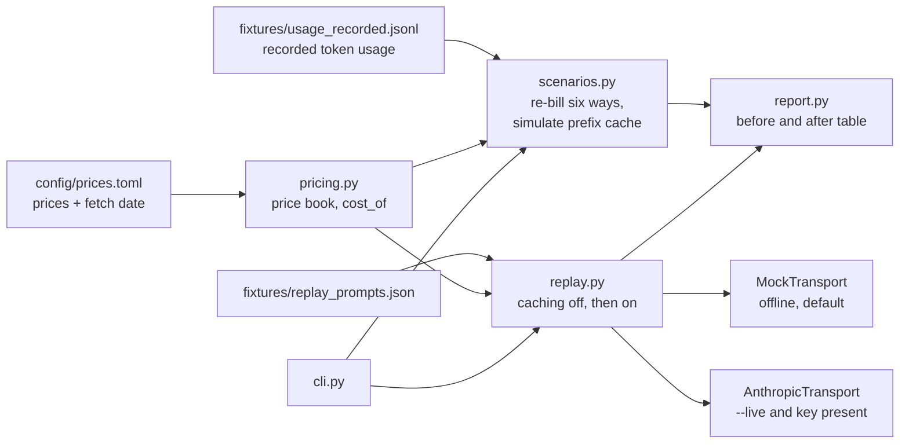

# prompt-cache-cost-lab

**Find out which change would cut your LLM bill the most, before you change anything.**

If your app sends the same long instructions with every request, you pay full input price for them every time. There are three common fixes: prompt caching, the Batch API, and a cheaper model. Which one saves the most depends on how your traffic arrives, so guessing is expensive.

This lab is for a team that already has a Claude workload and wants a number first. You give it a log of token counts per request. It bills those same requests six ways and prints a before and after table in dollars, with the catch that comes with each option.

- **Input:** one line per request (tokens in the stable part of the prompt, tokens in the rest, output tokens, a timestamp).
- **Output:** cost today, cost under each strategy, dollars and percent saved, and where the money goes.
- **Runs offline.** Python standard library only, no API key, no network.
- **Prices are not buried in code.** They sit in one dated file, `config/prices.toml`, and every report prints the source and the date.

What it is not: the shipped numbers come from an invented traffic log, and the table is a cost model, not a measurement of a real bill. See [Limitations](#limitations).

## What you will see

`python demo/run_demo.py`, first table, copied from the captured run in `demo/output.txt` (CI fails if the demo stops producing that file byte for byte):

```
Workload: usage_recorded.jsonl (48 requests)
Prices: https://platform.claude.com/docs/en/about-claude/pricing
Fetched on: 2026-11-24 (re-check before relying on these numbers)

BEFORE AND AFTER
Strategy                         Model               Before    After    Saved  Saved %
-------------------------------  -----------------  -------  -------  -------  -------
Prompt caching, 5 minute TTL     Claude Opus 5.5    $1.6999  $0.6880  $1.0118    59.5%
Prompt caching, 1 hour TTL       Claude Opus 5.5    $1.6999  $0.6657  $1.0342    60.8%
Batch API, no caching            Claude Opus 5.5    $1.6999  $0.8499  $0.8499    50.0%
Cheaper tier, no caching         Claude Sonnet 5.5  $1.6999  $0.8499  $0.8499    50.0%
Cheaper tier + 5 minute caching  Claude Sonnet 5.5  $1.6999  $0.3440  $1.3559    79.8%
```

The workload is synthetic: 48 requests in four bursts with idle gaps of 12, 25 and 70 minutes, each carrying a 6,200 token stable prefix. What the table shows for that shape:

- Caching alone beats both batch and the one step cheaper model, because the repeated prefix is most of the input.
- The 1 hour cache only just beats the 5 minute cache. It avoids two rewrites after idle gaps, but pays more for the two writes it does make.
- Output cost does not move under caching at all, so the more output heavy a workload is, the less caching helps.
- Caching can lose. Feed the lab a single request and the caching rows come out more expensive than the baseline, because a cache write costs more than plain input and nothing ever reads it.

## How it works

- `costlab report` reads the usage log and re-bills it as: no caching (the baseline), caching with a 5 minute TTL, caching with a 1 hour TTL, the Batch API, a cheaper model, and the cheaper model with caching.
- The prefix cache is simulated from the timestamps: the first request writes, a request that starts inside the TTL reads and refreshes it, a longer idle gap forces a rewrite. Prefixes under the cacheable minimum are billed as plain input.
- `costlab replay` sends a small prompt set twice, caching off and then on, and reports the usage each pass returned. By default it talks to an offline mock. With `--live` and a key it calls the real API (see [Limitations](#limitations): that path has never been run).
- Prices were copied by hand from the official Anthropic pricing page (https://platform.claude.com/docs/en/about-claude/pricing) on 2026-11-24. A price you cannot verify should be written as `"PLACEHOLDER"`; the lab refuses to cost a model with placeholders instead of guessing.

## Architecture



## Run it

Python 3.11 or newer. The lab itself has no dependencies.

```
python -m venv .venv && . .venv/bin/activate    # Windows: .venv\Scripts\activate
pip install -e ".[dev]"
costlab report
```

Other commands:

```
costlab report --cheaper claude-haiku-5-5          # pick a different cheaper tier
costlab report --usage path/to/your_usage.jsonl    # your own recorded usage
costlab replay                                     # offline mock replay
```

`python -m costlab` works the same as `costlab` once the package is installed.

### Your own usage

One JSON object per line. `t` is seconds since the first request. `prefix_tokens` is the part of the prompt that is identical on every request, `dynamic_tokens` is the rest of the input.

```
{"id": "req-001", "t": 0.0, "prefix_tokens": 6200, "dynamic_tokens": 754, "output_tokens": 304}
```

### Live replay

Sends real requests and costs real money: 12 requests with the shipped prompt set (6 questions, each sent with caching off and then on), each carrying a system prompt of roughly 3,600 tokens.

```
pip install -e ".[live]"
cp .env.example .env        # then put your key in ANTHROPIC_API_KEY
costlab replay --live --save fixtures/usage_live_run.jsonl
```

Without `--live`, or with `--live` and no `ANTHROPIC_API_KEY`, the runner falls back to the mock and says so in the first line of its output. Every row written by `--save` is tagged `"mode": "live"` or `"mode": "mock"`, so a fallback run cannot pass as a measured one. The saved file is for inspection; it is not in the format `costlab report --usage` reads.

## Tests

```
pytest -q
```

32 tests. They cover the cost arithmetic against hand computed totals, the cache simulation (TTL expiry, refresh on read, minimum prefix), the long prompt price tier, placeholder refusal, malformed price files, the mock replay, and the CLI. No network, no key. CI (`.github/workflows/ci.yml`) runs the tests on Python 3.11 and 3.12 and checks that the demo still produces the committed output.

## Demo

```
python demo/run_demo.py
```

Runs offline with nothing installed beyond Python 3.11 or newer. It prints three sections: the report above, the same report with the smallest model as the cheaper tier, and the mock replay. Full captured output is in `demo/output.txt`.

To regenerate the fixtures: `python scripts/make_fixtures.py` (seeded, same output every time).

## Where this pattern runs

The shape comes from assistants that answer the same kinds of questions all day against a long, stable set of instructions and reference notes. The question "is caching, batch or a smaller model the right lever for this job" comes up for each such workload, and it is cheaper to answer from recorded usage than from a month of invoices. No data, prompts or usage from any real system is in this repo.

## Limitations

What is mocked or never run:

- **The fixtures are synthetic.** `fixtures/usage_recorded.jsonl` is called "recorded" because that is the shape of file the tool expects, but it was generated by `scripts/make_fixtures.py`. Every dollar figure in this README describes that invented traffic, not a production workload or a real invoice.
- **The live path has never been run.** No key was used when this repo was built or tested, so `costlab replay --live` has not sent a single request. It is written against the official Python SDK's `messages.create` call with a `cache_control` breakpoint on the system block, and the only check made was that the installed SDK (2.13.0) accepts those parameters. Treat it as untested until you run it.
- **The default replay is a mock.** `MockTransport` estimates tokens at about four characters each and simulates the cache itself. It exercises the code path. It does not predict a bill.
- **Nothing has been compared with an invoice.** The arithmetic is tested against hand computed totals, not against billing data.

What the cost model leaves out:

- The Batch, cheaper tier and both caching rows are projections, not measurements. Only a live replay would measure real usage, and only for caching off versus on.
- The cache simulation assumes requests arrive one at a time. Concurrent requests that start before the first write finishes would each pay for a write; that is not modelled.
- The cheaper tier row assumes the same token counts and says nothing about answer quality. A smaller model may need more retries or longer prompts. Re-check quality before acting on that row.
- Batch plus caching is not modelled. The discounts stack, but cache hits inside a batch are not guaranteed, so any single number would be a guess.
- One stable prefix per workload. Multiple cache breakpoints, a growing conversation history, and tool definitions that change between requests are not modelled.
- The minimum cacheable prefix (512 tokens in `config/prices.toml`) does not come from the pricing page and was not independently verified. It is one value for all models; older models have higher minimums.
- Prices are a hand copied snapshot with no automatic refresh. Data residency, fast mode, cloud platform pricing and negotiated discounts are out of scope.
- In a live replay the two passes would not produce identical output. On models that think before answering, thinking tokens are billed as output, so the measured saving would include output noise as well as the caching effect.

License: MIT, see the LICENSE file.
