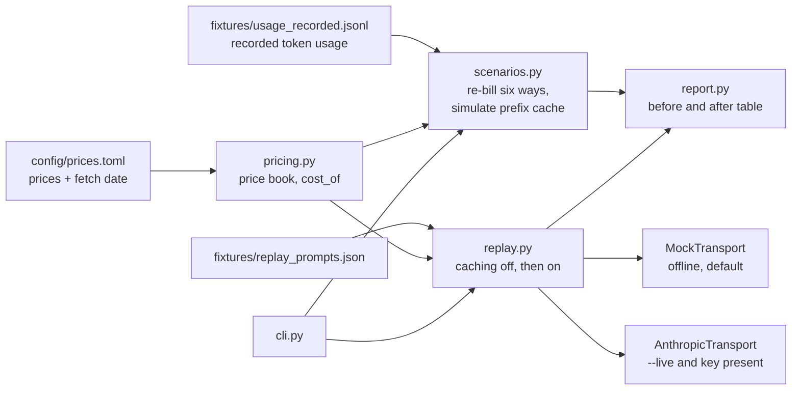

# prompt-cache-cost-lab

An LLM workload that resends the same long system prompt on every request pays full input price for it every time.
Caching, batch and a cheaper model tier can each cut that bill, but which one wins depends on the traffic shape, so this lab costs all of them from recorded usage.

## What it does

- Reads a fixture of recorded token usage for one workload (stable prefix, per request tail, output, timestamp).
- Re-bills the same requests six ways: no caching (the baseline), prompt caching with a 5 minute TTL, prompt caching with a 1 hour TTL, the Batch API, a cheaper model tier, and the cheaper tier with caching.
- Simulates the prefix cache from the timestamps: first request writes, requests inside the TTL read and refresh it, a longer idle gap forces a rewrite.
- Prints a before and after table plus a breakdown of where the dollars go.
- Includes a replay runner that sends a small prompt set with caching off and then on. It uses an offline mock by default and the real API when `--live` is passed and a key is present.

All prices live in one file, `config/prices.toml`. They were copied from the official Anthropic pricing page (https://platform.claude.com/docs/en/about-claude/pricing) on 2026-11-24, and the file records that date. Every report prints the source and the date. A price you cannot verify should be written as `"PLACEHOLDER"`; the lab refuses to cost a model with placeholders instead of guessing.

## Architecture



## Run it

Python 3.11 or newer. The lab itself has no dependencies.

```
python -m venv .venv && . .venv/bin/activate    # Windows: .venv\Scripts\activate
pip install -e ".[dev]"
costlab report
```

Other commands:

```
costlab report --cheaper claude-haiku-5-5          # pick a different cheaper tier
costlab report --usage path/to/your_usage.jsonl    # your own recorded usage
costlab replay                                     # offline mock replay
```

### Your own usage

One JSON object per line. `t` is seconds since the first request. `prefix_tokens` is the part of the prompt that is identical on every request, `dynamic_tokens` is the rest of the input.

```
{"id": "req-001", "t": 0.0, "prefix_tokens": 6200, "dynamic_tokens": 754, "output_tokens": 304}
```

### Live replay

Sends real requests and costs real money (12 short requests with the shipped prompt set).

```
pip install -e ".[live]"
cp .env.example .env        # then put your key in ANTHROPIC_API_KEY
costlab replay --live --save fixtures/usage_live_run.jsonl
```

Without `--live`, or with `--live` and no key, the runner falls back to the mock and says so in the first line of its output.

## Tests

```
pytest -q
```

27 tests. They cover the cost arithmetic against hand computed totals, the cache simulation (TTL expiry, refresh on read, minimum prefix), the long prompt price tier, placeholder refusal, the mock replay, and the CLI. No network, no key. CI (`.github/workflows/ci.yml`) runs the tests on Python 3.11 and 3.12 and checks that the demo still produces the committed output.

## Demo

```
python demo/run_demo.py
```

Runs offline with nothing installed. Captured output is in `demo/output.txt`. The headline table, for the shipped synthetic fixture (48 requests in four bursts with idle gaps of 12, 25 and 70 minutes, a 6,200 token stable prefix):

```
Strategy                         Model               Before    After    Saved  Saved %
-------------------------------  -----------------  -------  -------  -------  -------
Prompt caching, 5 minute TTL     Claude Opus 5.5    $1.6999  $0.6880  $1.0118    59.5%
Prompt caching, 1 hour TTL       Claude Opus 5.5    $1.6999  $0.6657  $1.0342    60.8%
Batch API, no caching            Claude Opus 5.5    $1.6999  $0.8499  $0.8499    50.0%
Cheaper tier, no caching         Claude Sonnet 5.5  $1.6999  $0.8499  $0.8499    50.0%
Cheaper tier + 5 minute caching  Claude Sonnet 5.5  $1.6999  $0.3440  $1.3559    79.8%
```

Things the table shows for this traffic shape: caching alone beats both batch and the one step cheaper tier, because the prefix dominates the input. The 1 hour TTL only just beats the 5 minute TTL, because it saves two rewrites but pays more for the two writes it does make. Output cost does not move under caching at all, so the more output heavy a workload is, the less caching helps.

To regenerate the fixtures: `python scripts/make_fixtures.py` (seeded, same output every time).

## Where this pattern runs

This is drawn from systems that run two small service companies day to day, where assistants answer the same kinds of questions all day against a long, stable set of instructions and reference notes. The question "is caching, batch or a smaller model the right lever for this job" comes up for each workload, and the answer is cheaper to get from recorded usage than from a month of invoices.

## Limitations

- The fixtures are synthetic. The numbers above describe an invented traffic shape, not a measured production workload.
- The Batch, cheaper tier and both caching rows on recorded usage are projections from a cost model, not measurements. Only `costlab replay --live` measures real usage, and only for caching off versus on.
- The live path was not exercised when this repo was built (no key was used). It is written against the official SDK's documented `messages.create` call with a `cache_control` breakpoint on the system block, but treat it as untested until you run it.
- The cache simulation assumes requests arrive one at a time. Concurrent requests that start before the first write finishes would each pay for a write; that is not modelled.
- The cheaper tier row assumes the same token counts and says nothing about answer quality. A smaller model may need more retries or longer prompts. Re-check quality before acting on that row.
- Batch plus caching is not modelled. The discounts stack, but cache hits inside a batch are not guaranteed, so any single number would be a guess.
- The minimum cacheable prefix (512 tokens in `config/prices.toml`) does not come from the pricing page and was not independently verified.
- Prices are a snapshot. Data residency, fast mode, cloud platform pricing and negotiated discounts are out of scope.
- The mock transport estimates tokens at about four characters each. It exists to exercise the code path, not to predict a bill.
- On models that think before answering, thinking tokens are billed as output and show up in live replay usage.

License: MIT, see the LICENSE file.
